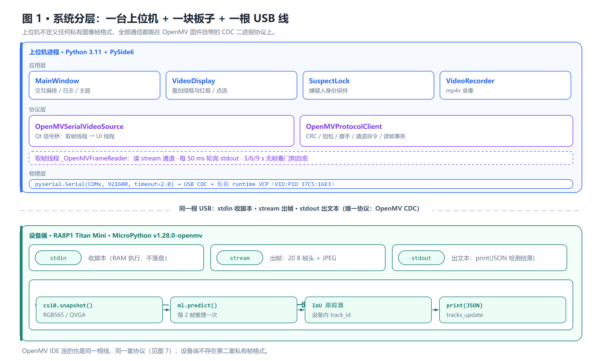
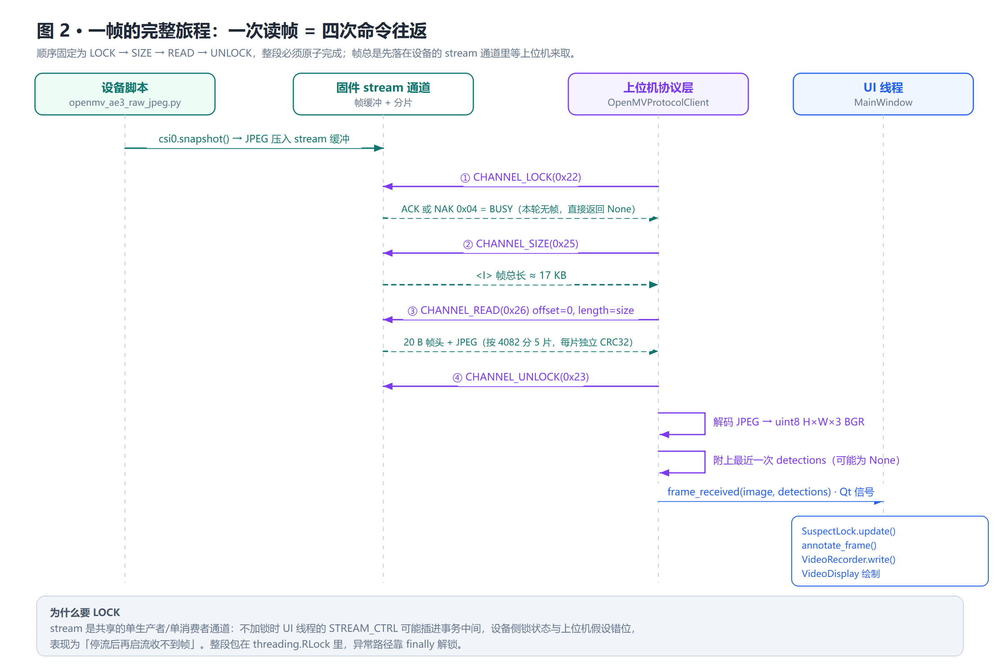
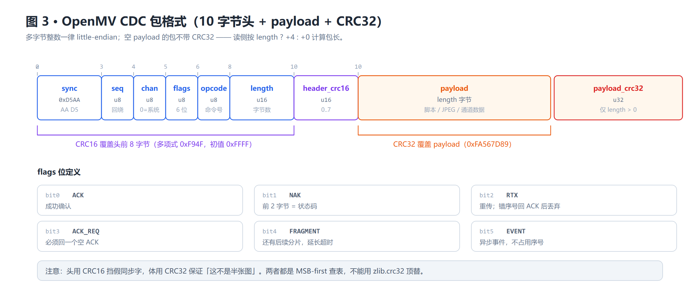
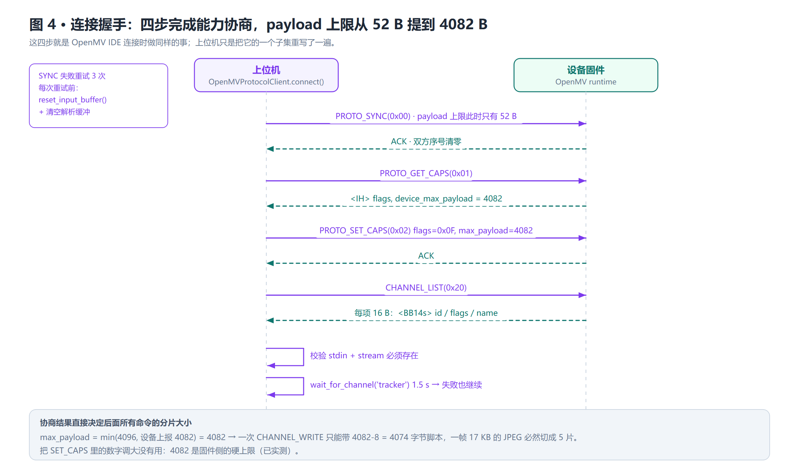
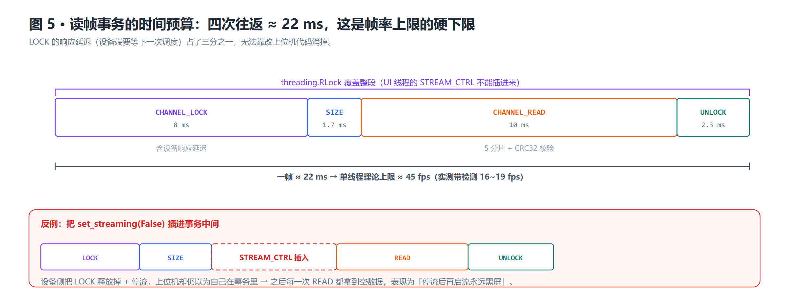
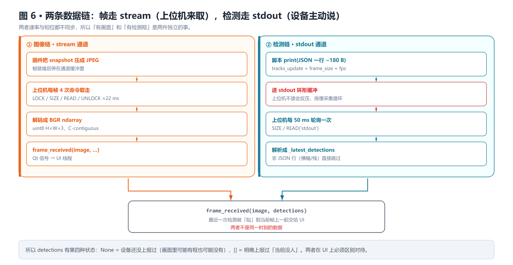
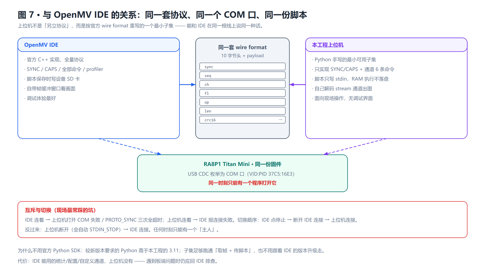

# Titan 嫌疑人追踪系统 · 工程介绍

## 0. 速览

| 项目 | 内容 |
| --- | --- |
| 定位 | 现场单板 + 单 PC 的嫌疑人识别与追踪控制台 |
| 上位机 | Python 3.11 + PySide6 6.7 + OpenCV + pyserial，打包为单文件 EXE |
| 板端 | RA8P1 Titan Mini，MicroPython v1.28.0-openmv，Ethos-U55 NPU |
| 板端模型 | `yolov8n_coco80_192_u55_256.tflite` + 固件自带 YoloV8 后处理器（person = class 0） |
| 链路 | USB CDC（枚举为 COM 口），**OpenMV CDC 二进制协议**（与 IDE 同一套），921600 仅为驱动兼容参数 |
| 采集分辨率 | QVGA 320×240（默认）/ VGA 640×480 |
| 实测帧率 | QVGA 无检测 ~25 fps，带检测 16~19 fps；VGA 带检测 ~8 fps |
| 锁定方式 | 推流时**点击画面中的行人**（就近吸附），无冻结帧、无框选、无下行依赖 |
| 输出 | `<程序目录>\log\*_YYYY-MM-DD.log`、`<程序目录>\recordings\*.mp4` |

---

## 1. 系统分层与数据流

### 1.1 三层结构



- **应用层**：`MainWindow` 编排交互，`VideoDisplay` 叠加绿框/红框并处理点选，
  `SuspectLock` 维持嫌疑人身份，`VideoRecorder` 写 MP4。
- **协议层**：`OpenMVSerialVideoSource` 是 Qt 信号桥，把取帧线程的结果跨线程递给 UI；
  `OpenMVProtocolClient` 是协议本体（CRC、组包、握手、通道命令、读帧事务）；
  `_OpenMVFrameReader` 是后台线程，读 `stream`、每 50 ms 轮询 `stdout`、带 3/6/9 s 看门狗。
- **物理层**：pyserial 打开 COM 口，走 USB CDC（板载 runtime VCP，`VID:PID 37C5:16E3`）。
- **设备端**：`src/device/openmv_ae3_raw_jpeg.py` 单文件脚本，`csi` 采集 → 每 2 帧推理 →
  设备内 IoU 跟踪 → `print(JSON)`。图像本身由固件的 `stream` 通道推送，脚本不碰 USB 字节。

### 1.2 一帧的完整旅程



要点：**帧和检测走的是两条独立通道，时序上不同步**（详见 §3.10 与图 6）。帧走 `stream`
（固件主动放进取走），检测走 `stdout`（上位机轮询），上位机把"最近一次检测"附着在
"当前帧"上一起送 UI。这也是为什么 `detections=None`（还没上报过）和 `detections=[]`
（画面里确实没人）必须区分对待。

---

## 2. 目录与模块职责

所有源码都在 `src/` 下，仓库根目录只留配置、脚本和文档：

```
titan_mini_suspect_tracker/
├── src/
│   ├── suspect_tracker/      上位机应用包（PYTHONPATH=src 后 python -m suspect_tracker 启动）
├── docs/                     工程介绍、协议说明、排查记录、diagrams/*.png
├── build_exe.ps1             PyInstaller 打包
├── run_ui.bat                源码方式启动
├── requirements.txt          运行期依赖（锁定版本）
├── requirements-build.txt    构建期依赖
└── pyproject.toml            包元数据 + ruff 配置
```

| 路径 | 职责 |
| --- | --- |
| `src/suspect_tracker/__main__.py` | 启动器：单实例检查（早于 PySide6 导入）→ 启动日志 → 调 `app.main()` |
| `src/suspect_tracker/app.py` | 创建 QApplication / MainWindow，注册命名管道回调 |
| `src/suspect_tracker/openmv_protocol.py` | **协议实现核心**：CRC、组包、握手、通道命令、读帧事务 |
| `src/suspect_tracker/hardware_video.py` | 打开 COM、上传脚本、解码像素、Qt 信号桥、看门狗 |
| `src/suspect_tracker/protocol.py` | 控制面 JSON Lines 的 `ProtocolFrame` 数据类 |
| `src/suspect_tracker/suspect_lock.py` | Host 侧嫌疑人身份保持器（运动预测 + 外观门控 + 歧义拒绝） |
| `src/suspect_tracker/video.py` | `Detection`、`VideoRecorder`（mp4v）、`annotate_frame`、`MockVideoSource` |
| `src/suspect_tracker/paths.py` | 输出路径策略（程序目录 / 按天分文件 / 不可写回退） |
| `src/suspect_tracker/single_instance.py` | Win32 互斥体 + `QLocalServer` 命名管道 |
| `src/suspect_tracker/ui/main_window.py` | 全部交互编排：连接、推流、点选、录像、日志、语言/主题 |
| `src/suspect_tracker/ui/video_display.py` | 自绘叠加层：绿框全量检测 + 红框嫌疑人 + 就近点击命中 |
| `src/suspect_tracker/ui/i18n.py` | 中英文案 + 驱动英文诊断的本地化重渲染 |
| `src/suspect_tracker/ui/themes.py` | 三套 QSS 配色 |
| `src/device/openmv_ae3_raw_jpeg.py` | **设备端脚本（唯一真源）**，IDE 与上位机共用同一份文本 |
|                                           |                                                              |

---

## 3. 协议实现

### 3.1 只有一套协议：与 OpenMV IDE 同源

这条链路上**从头到尾只有一种协议**：OpenMV 固件自带的 CDC 二进制协议。它的设计目标是
让任何实现方（官方 IDE、官方 Python SDK、第三方工具）都能在同一根 USB 线上与固件对话：

- 固件侧把能力暴露成**通道（channel）**：`stdin` 收脚本、`stream` 出帧、`stdout` 出文本；
- 主机侧用一组**二进制命令**（`SYNC` / `GET_CAPS` / `SET_CAPS` / `CHANNEL_*`）与通道交互；
- 所有命令和数据的**帧格式完全一致**（见 §3.2），区别只在 opcode 和通道号。

OpenMV IDE 连接板子时执行的就是这套流程；本工程实现的是其中视频链路必需的子集
（`SYNC`、`GET_CAPS`、`SET_CAPS`、通道 6 条命令 + 读帧）。所以：

> 上位机能连上板子，不是因为它"兼容"了 OpenMV，而是因为它**就是**在说 OpenMV 的协议。
> 反过来，凡是 IDE 能连上的场景，上位机的协议层同样能连 —— 两者是同一套语言的两个说话者。

### 3.2 CDC 二进制帧格式



所有多字节整数 **little-endian**。固定 10 字节头；payload 非空时尾部再附 4 字节 CRC32。
**空 payload 不附 CRC32**（这一点很容易写错，读侧也按 `length ? +4 : +0` 计算包长）。

```python
HEADER_WITHOUT_CRC = struct.Struct("<HBBBBH")   # 打头时先不带 CRC
HEADER            = struct.Struct("<HBBBBHH")   # 收包时一次解出 CRC
HEADER_SIZE       = 10
```

CRC 参数（**不是** zlib 的 CRC32，不能用 `zlib.crc32` 顶替）：

| | 多项式 | 初值 | 覆盖范围 | 实现 |
| --- | --- | --- | --- | --- |
| CRC16 | `0xF94F` | `0xFFFF` | 头前 8 字节 | 256 项 MSB 查表 |
| CRC32 | `0xFA567D89` | `0xFFFFFFFF` | payload | 256 项 MSB 查表 |

**为什么头用 CRC16、体用 CRC32**：头要逐包频繁校验（每帧 4 次命令往返），16 位足够挡住
同步字误命中；payload 可能是 17 KB 的 JPEG，需要 32 位来保证"这不是半张图"。实测
17 KB 帧的 CRC32 从逐位实现的 ~26 ms 降到查表后的 ~3.9 ms —— 这是 16 fps → 27 fps 的主因。

### 3.3 标志位与响应语义

| Bit | 名称 | 处理规则 |
| --- | --- | --- |
| 0 | `ACK` | 成功确认 |
| 1 | `NAK` | 失败；payload 前 2 字节为状态码 |
| 2 | `RTX` | 重传包；序号不是期望值时**回一个 ACK 然后丢弃** |
| 3 | `ACK_REQ` | 必须回一个空 ACK（同 opcode/channel/sequence） |
| 4 | `FRAGMENT` | 还有后续分片，继续累积 payload 并延长超时 |
| 5 | `EVENT` | 异步事件，**不消费命令序号**，直接跳过 |

`_receive_response()` 的判定顺序是有讲究的：
先处理 `RTX`+错序号 → 再处理 `ACK_REQ` 回 ACK → 再跳过 `EVENT` → 才做
`opcode/channel` 匹配 → 最后校验序号。顺序颠倒会让设备的异步事件打断命令事务。

NAK 状态码有两个特殊分支（其余一律抛错并写日志）：

| 状态 | 名称 | 上位机的处理 |
| --- | --- | --- |
| `0x04` | BUSY | 返回 `False`（`CHANNEL_LOCK` 拿不到锁时走这条，属正常"暂时没帧"） |
| `0x06` | SEQUENCE | 抛 `OpenMVSequenceError` → 触发重新同步并重放命令 |
| 其他 | FAILED / INVALID / TIMEOUT / CHECKSUM / OVERFLOW … | 抛 `OpenMVProtocolError`，把原始码打进 `hardware.log` |

### 3.4 连接握手：四步 + 载荷上限协商



关键约束：

1. **初始 payload 只能是 52 字节**。同步阶段设备还没协商能力，用大包会超限。
2. 同步失败重试 **3 次**，每次前都 `reset_input_buffer()` + 清空解析缓冲，避免上一次的
   残留字节把这次握手带偏（这是早期"能连上但不稳定"的根因之一）。
3. `max_payload = min(4096, 设备上报值)`，且下限 64。设备硬上限是 **4082**，
   所以 17 KB 的帧必然被切成 5 片，`SET_CAPS` 调大也没用（已实测，勿再试）。
4. 握手成功后校验 `stdin` 与 `stream` **必须存在**，缺一个就直接报错——这两个是视频链路的
   最低要求，其他通道（`stdout`）都是可选增强。

### 3.5 通道命令与 payload 布局

| 命令 | opcode | 请求 payload | 响应 |
| --- | ---: | --- | --- |
| `CHANNEL_LIST` | `0x20` | — | 每 16 字节 `<BB14s>` |
| `CHANNEL_LOCK` | `0x22` | — | ACK / NAK `0x04`(BUSY) |
| `CHANNEL_UNLOCK` | `0x23` | — | ACK |
| `CHANNEL_SIZE` | `0x25` | — | `<I>` 可读字节数 |
| `CHANNEL_READ` | `0x26` | `<II>` offset, length | 数据（可能多分片） |
| `CHANNEL_WRITE` | `0x27` | `<II>` offset, length + bytes | ACK |
| `CHANNEL_IOCTL` | `0x28` | `<I>` ioctl + 参数 | ACK |

写脚本时的分块大小是 `max_payload - 8`：因为 `CHANNEL_WRITE` 的 payload 里
前 8 字节被 `offset + length` 占掉了。

`stdin` ioctl：`STDIN_STOP=1`（中断现有脚本）、`STDIN_EXEC=2`（执行缓冲区脚本）、
`STDIN_RESET=3`（清空缓冲区）。
`stream` ioctl：`STREAM_CTRL=0`（`<I>` 0/1 开关推流）、`STREAM_RAW_CTRL=1`（`<I>` 0 = 非 raw）。

### 3.6 序号同步：这条链路最容易坏、也最容易修好的地方

**问题**：设备端脚本一启动或一中断，**设备侧协议计数器会清零，而上位机还在往上数**。
于是下一条命令的响应序号是 0，而期望值是 N → 报 `sequence mismatch: expected N, got 0`。

**三级处理**（`_command` 里的 `resync_budget` + `allow_relax`）：

```text
收到序号不符
   ├─ 第 1 级：PROTO_SYNC 重新对时（两侧同时归零）→ 重放该命令
   ├─ 第 2 级：再对一次仍不符 → _strict_sequence = False（宽松模式）→ 重放
   └─ 第 3 级：宽松模式下只告警不拒绝，靠 CRC16/CRC32 + opcode/channel 匹配兜底
```

宽松模式一旦打开就**本次会话不再回头**，并且每次发包前先 flush 输入缓冲，保证"下一条匹配
到同 opcode/channel 的包只可能属于这条命令"。这条设计让"脚本重启导致失步"从致命故障
降级成了日志里一行提示——早期版本正是因为它直接断开连接，才出现"连接成功但没图像"。

另外 `NAK 0x06` 被明确识别为**可恢复失步**，而不是链路故障。

### 3.7 接收端组包状态机

USB `read()` 的边界和协议包边界完全无关：一次可能只到半个头，也可能一次到三个包。所以
`_receive_packet()` 是一个带自愈的增量解析器：

```text
1. 找 sync(0xD5AA)；找不到 → 只保留最后 1 字节（跨 chunk 的半截同步字）
2. 找到但前面有垃圾 → 丢掉前缀
3. 缓冲不足 10 字节 → 继续读
4. 解头；length > max_payload → 丢 1 字节后重新找 sync（防被垃圾 length 卡死）
5. header CRC16 不符 → 丢 1 字节后重新找 sync
6. 按 10 + length + (length?4:0) 等齐；不足 → 继续读
7. payload CRC32 不符 → 丢 1 字节后重新找 sync（不是丢整包，避免误判后连锁丢帧）
8. 成功 → 从缓冲头部删除整包并返回
```

"失败就只丢 1 字节"是刻意的：如果错误判断了一个假同步字，丢整包会把后面真正的包也一起
吃掉；丢 1 字节只会多扫几个位置，代价可控。

### 3.8 视频帧在 stream 通道内的布局

`CHANNEL_SIZE` 拿到的是**整个通道 payload 的长度**，其中前 20 字节是帧头：

| 字段 | 类型 | 说明 |
| --- | --- | --- |
| `width` | `u32` | 宽 |
| `height` | `u32` | 高 |
| `pixformat` | `u32` | 见下表 |
| `depth` | `u32` | 位深（当前不使用） |
| `data_offset` | `u32` | 图像数据起始偏移 |

**不要假设 `data_offset == 20`**：固件可能加 padding 或其他字段。代码里做的是
`20 <= data_offset <= len` 的合法性校验，然后取 `data[data_offset:]`。

| 格式 | 常量 | 解码 |
| --- | ---: | --- |
| 灰阶 | `0x08020001` | 1 B/px → `cv2.COLOR_GRAY2BGR` |
| RGB565 | `0x0C030002` | 2 B/px，拆 R5/G6/B5 扩到 8 位 |
| JPEG | `0x06060000` | `cv2.imdecode` |

RGB565 扩位时必须用**足够宽的中间类型**（`np.uint16` 再乘 255 除 31/63），直接
`uint8 * 255` 会溢出成花屏。解码后统一转成 `uint8 H×W×3 / BGR / C-contiguous`，
这是 UI、绘制、录像三处的公共约定。

### 3.9 读帧事务与并发保护



一帧必须作为**一个串行事务**完成：

```python
with self._io_lock:                 # RLock，保护整段
    if not CHANNEL_LOCK(stream):    # NAK 0x04 = BUSY → 本轮无帧
        return None
    try:
        size = CHANNEL_SIZE(stream)
        if size <= 20:              # 头都不够，视为无帧
            return None
        data = CHANNEL_READ(stream, 0, size)
        width, height, fmt, depth, off = <IIIII>(data)
        return width, height, fmt, depth, data[off:]
    finally:
        CHANNEL_UNLOCK(stream)      # 异常路径也必须解锁
```

`self._io_lock` 是必须的：取帧线程和 UI 线程（点"停止视频流"会发 `STREAM_CTRL=0`）会同时
碰同一个串口。如果 `LOCK … UNLOCK` 中间插进一条 `set_streaming(False)`，设备侧的锁状态和
上位机的假设就会错位，表现为"停流后再启流就收不到帧"。

### 3.10 设备 → 上位机：stdout 上的 JSON Lines



这块板子上，**设备唯一能主动说话的地方是 `stdout`**（`print()` 的输出）。所以检测结果走这里：

```json
{"kind":"event","name":"tracks_update","payload":{
  "tracks":[{"track_id":7,"bbox":[112,58,198,236],"confidence":0.874,"label":"person"}],
  "frame_size":[320,240],"fps":18.3}}
```

| 字段 | 说明 |
| --- | --- |
| `tracks[].track_id` | 设备内 IoU 跟踪器分配的稳定 ID |
| `tracks[].bbox` | `[x1,y1,x2,y2]`，**已是图像像素坐标**，上位机不换算 |
| `confidence` | YoloV8 后处理器给出的分数（阈值 0.3） |
| `frame_size` | 采集分辨率，便于分辨率切换时校验 |
| `fps` | 设备自报采集帧率，显示在状态栏"设备采集 Y fps" |

上位机侧的三个工程决策：

1. **轮询间隔 50 ms**（`STDOUT_POLL_INTERVAL`）。每帧轮询实测要掉 ~9 fps（每次都是串口往返），
   而 50 ms 和 20 ms 对帧率无差别。检测框晚 50 ms 无害，视频掉帧有害。
2. **解析失败就跳过**。`stdout` 里还有 REPL 横幅、`>>>` 提示符、MicroPython traceback，
   这些都不是 JSON。用 `try/except` 吞掉，继续看下一行。
3. **反压是真实风险**。`stdout` 是环形缓冲，上位机不读会**阻塞 `print()` 并拖慢采集循环**。
   所以一行 JSON 只有 ~180 字节、`REPORT_EVERY = 1`（每拍报一次），靠低体积而不是靠降频来
   避免反压。

### 3.11 上位机 → 设备：控制面的设计与现实

**设计意图**：设备脚本用 `protocol` 模块注册一个 `tracker` 通道，上位机把
`ProtocolFrame` 序列化成 JSON Lines 写进去，设备回传事件走同一通道。

**实测现实**：现场固件（RA8P1 Titan Mini）**没有 `protocol` 模块**，`import protocol` 直接
`ImportError`，`omv` 模块也没有任何通道 API。所以 `tracker` 通道**永远不存在**。

代码对此的处理是"优雅降级"而不是"连接失败"：

```python
try:
    client.wait_for_channel("tracker", timeout=1.5)
except (TimeoutError, OpenMVProtocolError):
    self.control_available = False       # 只降级，不抛
```

```python
def send_command(self, frame):
    if not self.control_available:
        raise ControlChannelUnavailable("...没有 tracker 通道...")
```

于是所有控制命令都变成"记录一条日志然后跳过"：

| 命令 | 真实效果 |
| --- | --- |
| `start_stream` / `stop_stream` | **不靠命令**。`video_source.start()/stop()` 直接发 `STREAM_CTRL`，所以视频启停是真实生效的 |
| `clear_suspect` / `start_recording` / `stop_recording` / `set_recording_mode` | 送不到设备；录像本来就在上位机本地做，所以功能不受影响 |
| `mark_suspect` | 已随冻结帧工作流一起删除（点选锁定不需要下行） |

**这不是缺陷，而是架构选择**：设备只负责"检测所有行人 + 报 ID"，"谁是嫌疑人"完全由上位机
锁定某个 `track_id` 决定。这样既绕开了无自定义通道的限制，也满足了"画面永不中断"的硬约束
（任何需要重启采集循环的下行方案都会断流）。

### 3.12 性能工程：实测出来的结论

| 阶段 | 实测 | 采取的动作 |
| --- | --- | --- |
| 设备端口径（IDE 直连 QVGA RGB565） | ~41 fps | 链路理论上限参考值 |
| 修复前上位机 | **~16 fps** | 定位到 CRC32 逐位实现 ~26 ms/17 KB |
| CRC 改查表 | ~3.9 ms/帧 | 16 → 27 fps（主因） |
| 去掉每轮固定 `sleep(1ms)` | 多分片帧少花 5~10 ms | 只在无新字节时睡 |
| NAK 轮询 5 → 2 ms | 减少空转等待 | 端到端 ~25 fps、0 错误 |
| 加设备端检测 `DETECT_EVERY=2` | 16~19 fps | 采集与推理解耦 |
| VGA 带检测 | ~8 fps（QVGA 为 15.6） | 分辨率做成可选项 |

**"每帧 4 次命令往返"是硬下限**：`LOCK ~8 ms（设备响应延迟）+ SIZE 1.7 + READ ~10 + UNLOCK 2.3 ≈ 22 ms`。

**已排除、勿再试**：

- 跨帧保持 `LOCK` —— 设备直接 NAK `0x01`，协议要求每帧一次事务；
- 把 `max_payload` 调大 —— 设备硬上限 4082；
- `slicing-by-4` CRC —— 等价但纯 Python 下只快 ~18%，复杂度不值。

---

## 4. 与 OpenMV IDE 的软件对接



这是本工程最容易被忽略、但日常最影响效率的一章。**同一块板子、同一根线、同一套固件，
OpenMV IDE 和本工程是"抢同一个座位"的关系**，理解这个关系能省掉大量"连不上/黑屏"的排查。

### 4.1 IDE 在这套协议里的位置

OpenMV IDE 并不是"另一套协议"。它对板子讲的也是本文第 3 章这套 CDC 二进制协议：
同步 → 协商能力 → 列通道 → 往 `stdin` 写脚本 → 从 `stream` 取帧。区别只在于**实现方**：

| | OpenMV IDE | 本工程 |
| --- | --- | --- |
| 协议实现 | 官方 C++ 实现（完整） | Python 手写的最小可用子集 |
| 覆盖能力 | 全量（`PROTO_STATS`/`PROTO_VERSION`/`SYS_*`/profiler/自定义通道…） | 仅 `SYNC` / `GET_CAPS` / `SET_CAPS` / 通道 6 条命令 + 读帧 |
| 占用 COM 口 | 连接时独占 | 连接时独占 |
| 脚本去哪 | 保存时**写设备文件系统**（SD） | 只写 `stdin` 缓冲区，**RAM 执行，不落盘** |
| 帧怎么看 | IDE 自带帧缓冲窗口 | 上位机 `stream` 通道解码后显示 |

上位机没有复用官方 `openmv-python` SDK 的原因很实际：较新版本的官方 SDK 要求的 Python
版本高于本工程的 3.11 环境。所以这里是"按官方 wire format 重写一个够用的子集"，能做到
**与 IDE 在同一根线上互不干扰地各说各话**，但不会被 IDE 的版本升级牵着走。

### 4.2 上位机是怎么实现对接的：从打开 COM 到出图

对接的全部动作发生在 `hardware_video.py:connect_device()`，按时间顺序：

```python
serial_port = serial.Serial(port, 921600, timeout=2.0)   # ① 打开 COM 口
client = OpenMVProtocolClient(serial_port, timeout=2.0, trace=log_openmv_event)
channels = client.connect()        # ② 四步握手（§3.4），拿到通道表
client.stop_script()               # ③ STDIN_STOP：停掉 IDE 或上次残留的脚本
time.sleep(0.5)
client.run_script(script_text)     # ④ 上传并执行采集脚本（见下）
time.sleep(0.3)                    #    等设备重启协议计数器
self._resolve_control_channel(client)   # ⑤ 探测 tracker 通道（预期失败，降级）
self.start()                       # ⑥ STREAM_CTRL=1 → 取帧线程开始跑
```

**④ 上传脚本**是理解"同协议"的最好例子 —— 上位机做的事和 IDE 的"运行"按钮一模一样，
只是用协议原语手工拼出来：

```python
def run_script(self, script: str) -> None:
    stdin_channel = self.channels["stdin"]
    self._channel_ioctl(stdin_channel, IOCTL_STDIN_RESET)      # 清空 stdin 缓冲
    script_data = script.encode("utf-8")
    chunk_size = max(1, self.max_payload - 8)                  # 4082-8 = 4074
    for offset in range(0, len(script_data), chunk_size):      # 分块 CHANNEL_WRITE
        chunk = script_data[offset : offset + chunk_size]
        self._command(CHANNEL_WRITE, stdin_channel,
                      struct.pack("<II", offset, len(chunk)) + chunk)
    self._channel_ioctl(stdin_channel, IOCTL_STDIN_EXEC)       # 设备开始执行
```

也就是说：**没有文件传输、没有私有通道、没有额外握手** —— 脚本就是一段 utf-8 文本，
按协议规定的 `CHANNEL_WRITE(offset, length, bytes)` 一块一块写进 `stdin` 通道，
再发一条 `STDIN_EXEC` 让固件执行。IDE 干的是同一件事，只是界面帮你包好了。

**⑥ 开流**同理：`set_streaming(True)` = 两条 `CHANNEL_IOCTL`
（先 `STREAM_RAW_CTRL=0` 声明非 raw，再 `STREAM_CTRL=1` 打开推流）。之后固件把每一帧
JPEG 放进 `stream` 通道，上位机取帧线程循环执行 §3.9 的四步事务把帧搬回来。

**出错怎么办**：每一步的原始协议交互都会以英文写入 `hardware_YYYY-MM-DD.log`
（连接阶段全量 trace，开始推流后自动静默，避免 25 fps 的日志洪泛）。排查"连不上/黑屏"
时先看这个文件，再看 §4.4 的互斥表。

---

## 5. 应用层设计

### 5.1 嫌疑人锁定：两层 ID 保持

设备端给出的 `track_id` 并不可靠：遮挡、快速移动、两人交叉后，它会**派发新 ID**，或者
**保留旧 ID 却指到另一个人身上**。早期上位机用"与最后已知框 IoU 最大者"重绑定，结果红框
经常跳到旁边站着的人身上。现在的方案是两层：

**第一层（设备端，`track-keeper` 块）** —— 让 ID 尽量稳定：

| 机制 | 参数 |
| --- | --- |
| 速度预测后再算 IoU | EMA `0.5`，位移 > `1.2×边长` 视为身份跳变并清零速度 |
| IoU + 中心距混合评分 | 距离门 `0.9×边长`，fallback 分数 `0.25 + 0.25×(1-d/reach)`（上限 0.5，永不超过真实重叠）|
| 匹配门限 / 最大漏检 | `IOU_MATCH_THRESHOLD = 0.25`、`MAX_MISSES = 8` |

**第二层（上位机，`SuspectLock`）** —— 决定"哪个检测还是嫌疑人"：

| 机制 | 参数 | 作用 |
| --- | --- | --- |
| 运动预测几何 | `0.7×IoU + 0.3×中心接近度` | 参考框跟着走的人，不滞后在原地 |
| 外观门控 | 躯干 HSV 直方图 16×8，EMA `α=0.25` | 不像嫌疑人的候选被折扣 |
| 拒绝猜测 | `ambiguity_ratio = 1.15` | 两个候选接近时不动作，等下一拍 |
| 确认窗口 | `confirm_updates = 2`（仅当有竞争时） | 新 ID 必须连续 2 拍胜出 |
| 宽限 | `grace_updates = 12` | 短丢失保持最后位置（VGA 上报率下约 2 秒） |
| 纯外观重捕获 | 外观 ≥ `0.60` + 几何 ≥ `0.12` + 唯一 | 人走远后从画面别处回来能重锁 |

**最关键的不变量**：`APPEARANCE_DISCOUNT(0.25) < relock_floor(0.30)`。
意思是"外观不像嫌疑人的人，即使几何上完全重合，也永远拿不到锁定"。这一条就是防跳人的
数学保证——不是靠调参调出来的手感，而是靠不等式。

已知局限（如实说明）：两人框高度重叠时，躯干区直方图互相污染，此时宁可保持不动，
等人分开后再由外观门控纠正。

### 5.2 点选交互

点击命中不是"必须点在框内"，而是**就近吸附**：

```python
distance = 点到框边缘的距离
radius   = max(6px, 0.35 × 框短边)
命中条件  = distance <= radius
```

取最近的框；距离相同时后画的（视觉上更上层的）优先。这样远处 35×45 的小目标也点得中。
点选后红框**立刻显示**（不等下一拍检测），视觉反馈没有延迟。

### 5.3 录像

| 项目 | 实现 |
| --- | --- |
| 编码 | `cv2.VideoWriter_fourcc(*"mp4v")`，尺寸取当前视频源 |
| 内容 | 只烧**红色嫌疑人框** + `suspect ID n`（ASCII，`cv2.putText` 不支持中文） |
| 尺寸守卫 | 帧尺寸与 writer 不符时 `resize`，而不是让 OpenCV 静默丢帧（曾导致空文件） |
| 保存时机 | MP4 索引在 `release()` 时写入，所以"录着的时候文件不可播放"是正常的 |
| 自动模式 | 锁定即开始；清除标记 / 关窗口 / 连续丢失 15 s 后自动结束并保存 |
| 文件名 | `suspect_YYYYMMDD_HHMMSS.mp4`，同秒冲突加 `_2`/`_3` 后缀 |

### 5.4 输出路径策略

```
<程序目录>\log\ui_events_YYYY-MM-DD.log     界面事件（操作、锁定、录像）
<程序目录>\log\hardware_YYYY-MM-DD.log      OpenMV 协议 trace（英文原文）
<程序目录>\log\startup_YYYY-MM-DD.log       启动阶段（含单实例、导入、异常栈）
<程序目录>\recordings\suspect_*.mp4
```

- 程序目录：打包时 `Path(sys.executable).parent`，源码运行时是工程根。
  **绝不能用 `sys._MEIPASS`**（onefile 的临时解压目录，退出即删）。
- 不可写时回退 `%LOCALAPPDATA%\TitanSuspectTracker`，用 `.write_probe` 探测并缓存结果。
- `paths.py` **只 import 标准库**，这样启动器在 cv2/PySide6 导入失败时仍能写日志。

### 5.5 单实例

现场只有一块板子，两个窗口只会互相抢 COM 口。实现分两层：

- **Win32 内核互斥体**（`ctypes`，零 Qt 依赖）决定归属：进程被强杀时内核自动回收，
  不会留下陈旧锁；源码运行与 EXE 用同名，所以开发版和发布版也互斥。
- **`QLocalServer` 命名管道**只负责把已有窗口叫到前台（`raise_` + `activateWindow` +
  `QApplication.alert` 任务栏闪烁兜底）。

两个已踩过的 Win32 坑：`release()` 必须真的 `CloseHandle`；`CreateMutexW` 成功后
`GetLastError()` 是残留值，必须先 `set_last_error(0)`，否则残留的 `183` 会让全新启动被
误判为"已有实例"。

### 5.6 界面与本地化

- 三套主题（`graphite` / `daylight` / `amber`，第三套显示名是 VS Code Black，键名不一致
  但内部一致，不影响使用）。
- 中英文案全部走 `i18n.text()`；驱动层发英文原文，UI 用 `i18n.diagnostic_text()` 按正则
  重渲染已知消息（约 10 条），未知消息原样透传。`hardware.log` 保持英文便于对照。

---

## 6. 质量保障

四个脚本都在 `src/tests/`，各自带 `sys.path` 引导，直接运行即可（无需手工设 `PYTHONPATH`）：

| 脚本 | 项数 | 覆盖 |
| --- | ---: | --- |
| `probe_ui_smoke.py` | **41 PASS** | 离屏跑完整 UI：点选锁定、身份保持（确认窗口/宽限/邻人不能接管）、红色只烧嫌疑人、日志目录、i18n 完整性、单实例提示 |
| `probe_suspect_lock.py` | **24 PASS** | 纯逻辑（无 Qt/无硬件）：旁人站在原位不能接管、交叉后 ID 指错人被纠正、双胞胎歧义不跳框、纯外观重捕获 |
| `probe_single_instance.py` | **11 PASS** | 同进程二次获取被拒、无管道时快速失败、真实跨进程激活、持有者被强杀后锁自动释放 |
| `probe_ui_layout.py` | — | 真实 Qt 平台截图，验证布局（最可靠的 UI 验证方式） |

运行：

```bash
.venv/Scripts/python.exe src/tests/probe_ui_smoke.py
.venv/Scripts/python.exe src/tests/probe_suspect_lock.py
.venv/Scripts/python.exe src/tests/probe_ui_layout.py out.png
```

---

## 7. 构建与部署

| 方式 | 命令 | 产物 |
| --- | --- | --- |
| 源码运行 | 双击 `run_ui.bat`（自动识别 `.venv`/`ui_venv`/`venv`，内部设 `PYTHONPATH=src`，用 `pythonw`） | 无窗口控制台 |
| 命令行 | `$env:PYTHONPATH="src"; python -m suspect_tracker` | |
| 打包 | `.\build_exe.ps1`（默认探测 `.venv`，可用 `-Venv <name>` 指定） | `dist\TitanSuspectTracker.exe`（onefile，~104 MB） |

打包的关键一行是 spec / 脚本里的：

```
--add-data "src\device\openmv_ae3_raw_jpeg.py;device"
```

**设备端脚本必须打进 EXE**，否则现场只有 EXE 时连不上相机（`_openmv_script_path()` 在
frozen 模式下会去 `_MEIPASS/device/` 找它）。

依赖（版本以 `requirements.txt` 的锁定值为准，下表为实测通过的组合）：

| 包 | 版本 | 用途 |
|---|---|---|
| `PySide6` | 6.11.2 | Qt 6.11 绑定，完整包（含 Essentials + Addons，后者提供 `QtSvg`） |
| `numpy` | 2.4.6 | 图像缓冲、直方图运算 |
| `opencv-python` | 5.0.0.93 | 录像写入（mp4v）、`BGR↔RGB` 转换、JPEG 编解码 |
| `pyserial` | 3.5 | OpenMV USB CDC 虚拟串口，唯一的设备通信依赖 |
| `pyinstaller` | 6.22.3 | 仅打包用，见 `requirements-build.txt` |

`pyusb` 已从依赖中移除：源码里没有任何 `usb` 调用，设备链路全程走 pyserial。

---

## 8. 已知边界与限制

| 限制 | 说明 |
| --- | --- |
| 无下行控制通道 | 固件无 `protocol` 模块，控制命令送不到设备；只影响"远程改参数"，不影响视频与录像 |
| 检测结果滞后 | 走 stdout 轮询（50 ms），比帧晚半拍；锁定逻辑按"最新报告"更新，不按帧 |
| VGA 下 ID 抖动 | 检测间隔翻倍导致位移更大，设备端会换 ID；靠 §5.1 两层保持兜底 |
| 两人框高度重叠 | 直方图互染，此时宁可不动作 |
| 遮挡 > 8 拍 | 设备端会换 ID（约 1.4 s），由 host 快速重绑定兜底 |
| 分辨率仅两档 | QVGA / VGA；HVGA 被传感器拒绝（"Sensor control failed"） |
| 模型只能用 coco80 | `swift_yolo_person_nano`、`yolov5n6_xiao_voc20` 输出是已解码的非标准布局，固件后处理器二次解码出垃圾 → 检测恒空 |
| 设备端参数不可热更新 | 改参数 = 改脚本 = 重新上传（会重启采集循环，短暂断流） |

